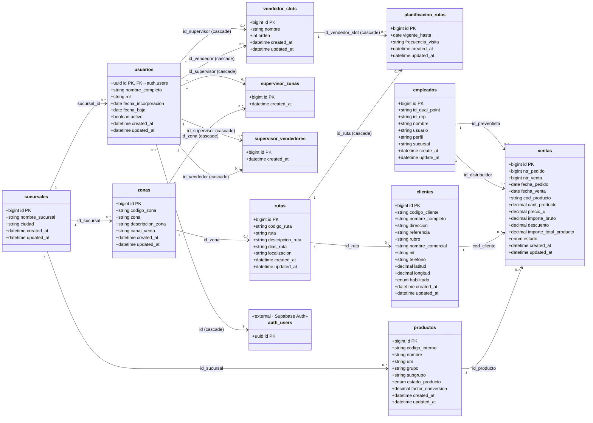

# Diagrama de clases — esquema inicial

Derivado de `supabase/migrations/20260830051823_esquema_inicial.sql`. Fuente de verdad del diagrama: [`esquema_inicial.class-diagram.mmd`](./esquema_inicial.class-diagram.mmd) (este archivo la embebe para previsualizarla en VS Code).

## Notas de lectura

1. `usuarios` extiende `auth.users` de Supabase (esquema externo) — su PK es también FK con `ON DELETE CASCADE`.
2. `supervisor_zonas` y `supervisor_vendedores` son clases de asociación M:N sobre `usuarios`: qué supervisor cubre qué zona, y qué supervisor gestiona qué vendedor — ambas relaciones caen sobre la misma tabla física.
3. `ventas` referencia dos veces a `empleados` (`id_preventista`, `id_distribuidor`); por eso ambas asociaciones llevan el nombre de la FK como rol.
4. `empleados.sucursal` es texto libre, no una FK hacia `sucursales` — a diferencia de `usuarios.sucursal_id`.
5. Las asociaciones marcadas `(cascade)` son las únicas con `ON DELETE CASCADE` en el SQL; el resto de las FK no tiene regla de borrado explícita.
