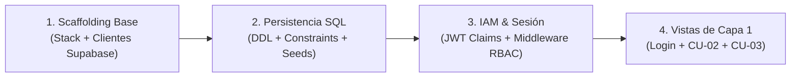

# Plan de Implementación — Fase 1 (Capa 1)
## Identidad Organizacional, Autenticación y Control de Acceso (RBAC)

- **Capa:** Capa 1 (Cimientos de Identidad y Seguridad)
- **Repositorio de Requisitos:** [`Ing_Req_Mod_Angelica`](../../Ing_Req_Mod_Angelica/)
- **Decisiones Base:** [ADR-001: Arquitectura de Identidad, Autenticación y RBAC](../../Ing_Req_Mod_Angelica/ADR/ADR-001-identidad-autenticacion-y-rbac.md)
- **Casos de Uso Implicados:** CU-01 (Iniciar sesión), CU-02 (Gestionar accesos y cuentas IAM), CU-03 (Gestionar personal comercial)
- **Requisito No Funcional:** RNF-03 (Seguridad y RBAC con alcance territorial)

---

## 1. Objetivo de la Fase

Establecer la infraestructura de seguridad, persistencia base y control de acceso de **Portal Watts**, garantizando que ninguna pantalla o endpoint posterior pueda ser consumido sin una sesión autenticada y permisos atómicos validados según la sucursal del colaborador.

---

## 2. Etapas de Construcción Secuenciales



### Etapa 1: Scaffolding e Infraestructura Base
* **Objetivo:** Disponer de la estructura de código limpia y los conectores hacia Supabase.
* **Tareas Técnicas:**
  1. Verificar dependencias del stack: Next.js (Pages Router), React 19, TypeScript 5, Tailwind CSS v4.
  2. Instalar el SDK cliente de Supabase: `@supabase/supabase-js` y helpers de autenticación.
  3. Crear clientes de Supabase desacoplados en `src/lib/supabase/`:
     * `client.ts`: Cliente de navegador (usa `NEXT_PUBLIC_SUPABASE_URL` y `NEXT_PUBLIC_SUPABASE_ANON_KEY`) con sesión basada en cookies/storage.
     * `server.ts`: Cliente de servidor para API Routes con `SUPABASE_SERVICE_ROLE_KEY` (privilegiado, para invitar usuarios y gestionar claims).
  4. Configurar estructura base de carpetas: `src/components/`, `src/hooks/`, `src/services/`, `src/types/`.

### Etapa 2: Capa de Persistencia y Migraciones SQL (Capa 1 DDL)
* **Objetivo:** Crear el esquema relacional en PostgreSQL bajo Supabase con integridad referencial estricta, restricciones de dominio e invariantes de negocio.
* **Delimitación de Alcance Académico (Exclusión de RLS):**
  Para evitar complejidad accidental y fallos silenciosos (*silent failures*) en un proyecto formativo de 3er semestre, **se excluye intencionalmente el uso de Row-Level Security (RLS) en PostgreSQL**. La segregación por sucursal y el control de acceso se delegan de forma explícita y transparente a las consultas y validaciones de la capa de aplicación (servicios y API Routes).
* **Tareas Técnicas:**
  1. Reemplazar la migración obsoleta por una nueva migración limpia `supabase/migrations/<timestamp>_capa1_identidad_rbac.sql`:
     * Tablas base: `sucursales`, `cargos`, `personas`, `asignaciones_laborales`, `roles`, `usuario_roles`.
     * `alcance_tipo`: texto con `CHECK` (`GLOBAL`, `SUCURSAL`); no se usan tipos `ENUM` de dominio.
     * Constraints e Invariantes de dominio (ADR-001):
       * `CHECK ((alcance_tipo = 'GLOBAL' AND id_sucursal IS NULL) OR (alcance_tipo = 'SUCURSAL' AND id_sucursal IS NOT NULL))`
       * Índice condicional: `UNIQUE (id_persona) WHERE (estado = 'activo')` en `asignaciones_laborales`.
       * Integridad referencial con claves foráneas explícitas y políticas de eliminación (`ON DELETE CASCADE`, `ON DELETE RESTRICT`, `ON DELETE SET NULL`).
  2. Crear script de datos semilla en `supabase/seed.sql`:
     * 2 sucursales: Santa Cruz e Interdepartamental.
     * 5 cargos: Gerencia Comercial, Fiscalizador, Supervisor, Vendedor, Distribuidor.
     * 4 roles RBAC: `GERENCIA_COMERCIAL`, `FISCALIZADOR`, `SUPERVISOR`, `VENDEDOR` con sus arreglos de permisos atómicos iniciales (`cuentas:gestionar`, `personal:gestionar`, etc.).
     * Usuarios de prueba iniciales para validar inicio de sesión y perfiles (incluyendo al Distribuidor sin rol digital).

### Etapa 3: Mecanismo de Autenticación y Contexto de Sesión (IAM + RBAC)
* **Objetivo:** Resolver el perfil y los permisos del colaborador al iniciar sesión.
* **Tareas Técnicas:**
  1. Configurar Supabase Auth para inicio de sesión por correo electrónico y contraseña (CU-01).
  2. Crear hook/contexto de sesión (`useAuth` / `SessionProvider`):
     * Al recibir el token JWT de `auth.users`, consultar en `personas` y `usuario_roles` para construir el objeto de sesión:
       ```typescript
       interface UserSession {
         id_persona: number;
         ci: string;
         nombre_completo: string;
         email: string;
         rol_codigo: string;
         alcance_tipo: 'GLOBAL' | 'SUCURSAL';
         id_sucursal: number | null;
         permisos: string[]; // e.g. ['cuentas:gestionar', 'personal:gestionar', ...]
       }
       ```
  3. Crear Middleware de Next.js (`middleware.ts`):
     * Proteger todas las rutas privadas (redirección a `/login` si no hay sesión activa).
     * Guardia de permisos: verificar que el usuario posea el permiso requerido antes de acceder a la ruta.

### Etapa 4: Interfaces Mínimas Funcionales (Vistas de Capa 1)
* **Objetivo:** Desarrollar las interfaces de usuario operativas de la primera capa.
* **Tareas Técnicas:**
  1. **CU-01 (Login):**
     * Vista de inicio de sesión (`src/pages/login.tsx`) adaptada tanto a escritorio como a celulares.
     * Redirección según rol (vendedor va a vista de mapa de campo; supervisores/fiscalizadores van a panel administrativo).
  2. **CU-02 (Administración de Cuentas y Roles):**
     * Panel para invitar colaboradores y asociar cuenta IAM (`auth.users`) con su registro en `personas`.
     * Asignación de rol (`usuario_roles`) y sucursal.
     * Botón de revocación inmediata de credenciales (offboarding digital seguro).
  3. **CU-03 (Administración de Personal Comercial):**
     * Listado y alta de colaboradores (`personas`).
     * Asignación de cargo vigente en `asignaciones_laborales`.
     * Filtro automático por sucursal si el usuario es `FISCALIZADOR`.

---

## 3. Criterios de Aceptación de la Fase 1

- [ ] `npx supabase db reset` ejecuta sin errores todas las tablas, constraints, claves foráneas y semillas de Capa 1.
- [ ] La capa de aplicación y consultas filtra adecuadamente para que un Fiscalizador solo consulte y administre colaboradores de su sucursal asignada.
- [ ] Un usuario puede iniciar sesión en la web y recibir en su contexto sus permisos y alcance territorial.
- [ ] La Gerencia Comercial puede asignar roles globales y locales.
- [ ] El Fiscalizador puede dar de alta colaboradores y habilitarles acceso exclusivamente dentro de su sucursal.
- [ ] El Distribuidor de prueba puede crearse como persona física con cargo laboral sin credenciales ni rol de sistema.
